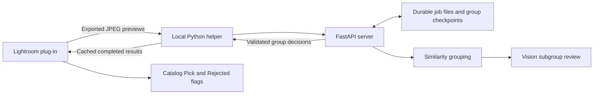

# PhotoPick AI — Lightroom Similar Photo Picker

Compare similar photos in **Adobe Lightroom Classic**, choose representatives,
and apply Pick/Rejected flags through a local AI server.

The Lightroom plug-in exports JPEG previews and calls a Python helper to submit
a background job. The server groups related previews and requests Vision model
decisions. You later check the job and apply its results to the original catalog.

**This workflow changes catalog flags. It does not move, delete, or edit
original image files.** Start with a backed-up test catalog and dry-run enabled.

## Guides

- [Lightroom, helper, and server setup](PhotoPickAI/README_Lightroom_Server.md)
- [Plug-in operations and preferences](LRPhotoPickAI.lrdevplugin/PhotoPickAI_BestPicker.lrdevplugin/README.md)
- [Architecture, shared processing code, and recovery design](docs/ARCHITECTURE.md)
- [Security and retained data](SECURITY.md)
- [Development and tests](CONTRIBUTING.md)

## Requirements and compatibility

| Component | Requirement and verification boundary |
|---|---|
| Lightroom | Plug-in declares SDK/minimum 6.0, version 1.1.0; no tested Lightroom release matrix is established |
| Server Python | Use Python 3.11+ with the shared processing and FastAPI requirements below |
| Helper Python | A working Python executable on the Lightroom computer; configured independently of the server |
| Vision model | An image-capable model with a compatible endpoint and matching model ID; model weights/runtime are not bundled |
| Photos | At least two selected photos by default; Lightroom must be able to export usable JPEG previews |
| Tests | 72 unit/mock tests passed in the existing Windows Python 3.14.4 environment during documentation preparation |

Tests cover shared processing, ingest, helper behavior, and job recovery. They
do not prove actual Lightroom/model compatibility or grouping quality on every
camera and scene.

## Server setup

From the repository root, install shared processing and server requirements:

```powershell
git clone https://github.com/emadaljumah-camel/PhotoPick-AI.git
cd PhotoPick-AI\PhotoPickAI
python -m venv .venv
.\.venv\Scripts\python.exe -m pip install -r requirements.txt
.\.venv\Scripts\python.exe -m pip install -r server\requirements.txt
```

Both requirement files are needed for the current shared processing layout.
For an existing installation, preserve its environment and review dependency
changes separately.

Create or edit the ignored local `PhotoPickAI/photopickai_server_config.yaml`
without overwriting existing settings. Set the model's base URL and exact loaded
image-capable model ID as described in the
[server configuration guide](PhotoPickAI/README_Lightroom_Server.md#server-setup).

Start LM Studio and load the model. Then, from the `PhotoPickAI` directory:

```powershell
.\.venv\Scripts\python.exe -m uvicorn server.main:app --host 127.0.0.1 --port 8000
```

Check `http://127.0.0.1:8000/health`. Health verifies the API process, not model
readiness. Leave the backend/model running while jobs process.

The supplied `PhotoPickAI/run_server.bat` explicitly binds `0.0.0.0:8000`.
Prefer the direct loopback command above for one-computer use; a loopback value
in YAML does not override explicit launcher arguments.

## Plug-in and helper setup

1. In **File > Plug-in Manager > Add**, select the complete
   [PhotoPickAI_BestPicker.lrdevplugin](LRPhotoPickAI.lrdevplugin/PhotoPickAI_BestPicker.lrdevplugin/)
   folder.
2. Select **03 PhotoPickAI Best Similar Picker**.
3. Set **Server URL** to `http://127.0.0.1:8000` for a direct local connection.
   The initial `http://localhost:8080/photopick` assumes an external proxy that
   this repository does not start.
4. Configure **Helper Python** to an executable on the Lightroom computer.
   Keep **Helper Script** pointing to the bundled `helper/lr_client_helper.py`.
5. Match the optional server API key and choose a job-storage root that will
   survive as long as recovery is needed.
6. Enable dry-run before your first test.

The helper is a local process on the Lightroom computer, even when the AI server
runs elsewhere. A Python executable installed only on the server cannot replace
that requirement.

See [complete helper and authentication instructions](PhotoPickAI/README_Lightroom_Server.md#helper-and-plug-in).

## First pair walkthrough

1. Select at least two similar test photos in a backed-up catalog.
2. Run **Library > Plug-in Extras > PhotoPickAI: Submit Selected Photos**.
3. Wait for successful queued acknowledgment. Submission does not change flags.
4. Keep the backend/model available. After acknowledgment, Lightroom may
   disconnect while the server processes the job.
5. Reconnect and run **PhotoPickAI: Check Job Status / Apply Results**.
6. If processing continues, check later. Interrupted/resumable jobs offer
   **Resume Job**.
7. Inspect the dry-run summary. For real flags, submit a new job with dry-run
   disabled, then check/apply that job when it completes.

Checking a completed non-dry-run job can immediately apply flags without a
separate per-photo approval screen. Representatives become **Pick**; alternatives
listed as rejected become **Rejected** if automatic rejection was enabled.
Existing flags can be overwritten.

Dry-run prevents flag writes, not exports, uploads, inference, or logging.
Saved job choices govern application; changing preferences afterward does not
convert an existing dry-run into a flag-writing job.

## Architecture and design



Deterministic grouping builds candidate sets using similarity and capture-time
context. Vision review can split broad groups into semantic subgroups and choose
representatives. Validation checks photo membership and coherent decisions.
A representative is a relative choice within a group, not an absolute
stock-quality verdict.

The server reuses shared code under `PhotoPickAI/app/`. Do not remove that
directory merely because this README focuses on Lightroom. Server jobs and
helper fingerprints enable recovery; they do not make catalog writes and local
completion markers one atomic transaction.

## Preferences and behavior

| Preference | Initial value |
|---|---|
| Server URL | Proxy example `http://localhost:8080/photopick`; change for direct use |
| Preview long edge / JPEG quality | 1024 pixels / 85 |
| Minimum selected count | 2 |
| Dry-run | Off |
| Auto-reject non-selected | On |
| Timeout | 120 seconds |
| Helper Python | `python` on the Lightroom computer's PATH |
| Helper script | Bundled `helper/lr_client_helper.py` |
| Job root | OS temporary directory/PhotoPickAI_LR_Jobs |

Saved preferences are preserved until reset. Select persistent job storage if
OS temporary cleanup could remove needed recovery files.

The application loop writes Pick/Rejected status for returned decisions.
It does not provide an existing-flag protection switch, original-flag snapshot,
or dedicated completed-job rollback routine.

## Recovery and rollback

Use **PhotoPickAI: Check Job Status / Apply Results** before submitting a
replacement solely because a response was lost.

- Helper fingerprints combine selection, settings, and preview hashes,
  independently of photo order.
- Incomplete submissions can reconnect and upload only needed previews.
- Server grouping and completed group decisions are checkpointed for resume.
- Completed results are cached locally for catalog-application retry.
- A deliberate new submission after completion can create a fresh review job.

Keep local and server job folders until work is resolved. Catalog/photo/result
checks precede application, but a crash can leave flag changes without a saved
completion marker. Inspect affected flags before retrying.

There is no server cancellation/deletion route. Closing a dialog or local job
does not establish that server work stopped. Neither stopping processing nor
deleting recovery files restores flags. Use appropriate Lightroom Undo tools
or a catalog backup, and verify restoration.

## Updates

1. Resolve active jobs, stop the backend, and back up the catalog, local YAML,
   helper job state, and server job folders.
2. Check `git status --short` and preserve local edits. For a clean checkout,
   use `git pull --ff-only`; do not discard changes to force the update.
3. Keep the existing virtual environment. From `PhotoPickAI`, run
   `.\.venv\Scripts\python.exe -m pip check` and review requirement changes
   separately. These instructions do not upgrade dependencies.
4. Preserve ignored `photopickai_server_config.yaml`. Update the complete
   separately installed plug-in, including its helper, with Lightroom closed;
   reload it afterward.
5. Restart the server and test health plus a one-pair dry-run before applying
   flags. Do not mix versions during an unresolved job.

## Security, privacy, and license

API-key checks protect job routes only when a nonempty server key is configured.
`PHOTOPICKAI_API_KEY` overrides the YAML key, including when explicitly empty.
A blank key permits access without authentication. Health is public; there is
no built-in TLS or per-user job isolation.

For two computers, use the server's private reachable address, explicitly bind
a suitable interface, and restrict firewall access. Protect transport and use
matching nonempty keys. Do not expose the API/model directly to the internet.

Previews, EXIF, filenames, original paths, responses, keys in preferences/helper
process arguments, and recovery artifacts can be sensitive. Remote model
endpoints receive previews. `keep_jobs_days` is read but automatic expiry is
not implemented. See [SECURITY.md](SECURITY.md).

Original code and documentation use the [MIT license](LICENSE). External
components retain their terms; see [THIRD_PARTY_NOTICES.md](THIRD_PARTY_NOTICES.md).
