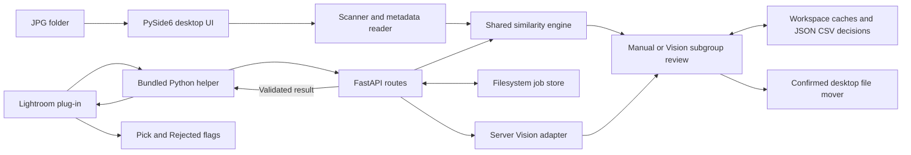
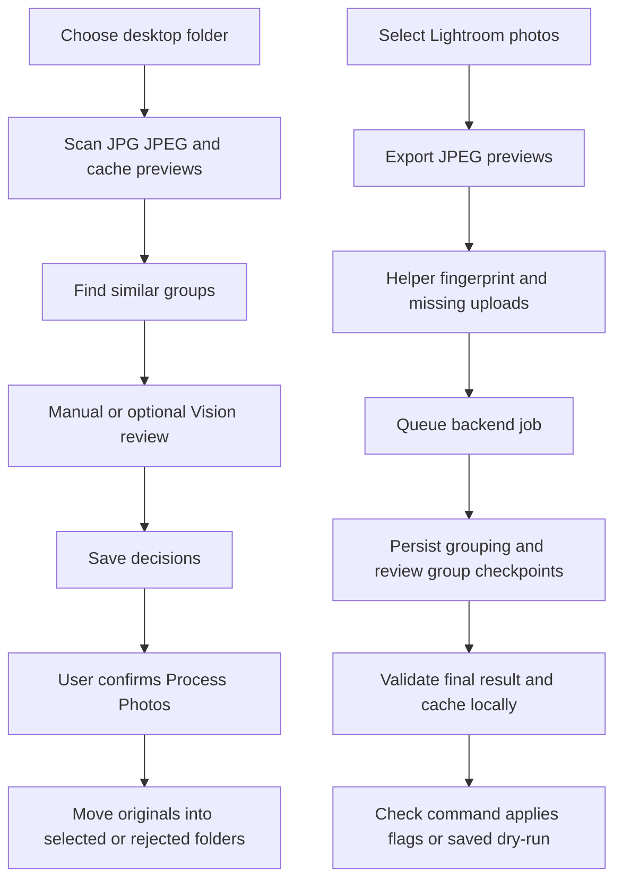

# Architecture, design, and workflow

PhotoPick AI has a desktop file-review workflow and a Lightroom client/server
workflow sharing grouping and Vision-review concepts. Their outputs and recovery
semantics are different; they must not be treated as one application mode.

## Component map

| Component | Implementation |
|---|---|
| Desktop UI/workers | [main_window.py](../PhotoPickAI/app/ui/main_window.py) |
| Folder/metadata/preview ingest | [scanner.py](../PhotoPickAI/app/core/scanner.py), [metadata_reader.py](../PhotoPickAI/app/core/metadata_reader.py), [preview_generator.py](../PhotoPickAI/app/core/preview_generator.py) |
| Similarity and candidate groups | [similarity_engine.py](../PhotoPickAI/app/core/similarity_engine.py) |
| AI subgroup selection | [vision_llm_reviewer.py](../PhotoPickAI/app/core/vision_llm_reviewer.py) |
| Saved review and original moves | [review_store.py](../PhotoPickAI/app/core/review_store.py), [photo_mover.py](../PhotoPickAI/app/core/photo_mover.py) |
| Server routes, execution, auth | [main.py](../PhotoPickAI/server/main.py), [security.py](../PhotoPickAI/server/security.py) |
| Server ingest/group/review | [photo_ingest.py](../PhotoPickAI/server/photo_ingest.py), [grouping_adapter.py](../PhotoPickAI/server/grouping_adapter.py), [vision_review_adapter.py](../PhotoPickAI/server/vision_review_adapter.py) |
| Persistence/result integrity | [job_store.py](../PhotoPickAI/server/job_store.py), [result_schema.py](../PhotoPickAI/server/result_schema.py) |
| Lightroom and helper | [plug-in](../LRPhotoPickAI.lrdevplugin/PhotoPickAI_BestPicker.lrdevplugin/), [source helper](../PhotoPickAI/client_helper/lr_client_helper.py) |

There is no learning/training database or absolute stock-agency quality gate.
A representative is a selection within a similar-photo subgroup, not a legal,
editorial-release, or commercial-acceptance decision.

## Design responsibilities

Deterministic code reads metadata, builds previews, calculates similarity,
creates comparison candidates, and suggests heuristic winners. Vision review
can split broad groups semantically and choose representatives. Validation
checks IDs, group membership, coverage, and coherent representative/rejected
decisions. These constraints do not prove that the visual choice is correct.

Desktop users review choices before the confirmed finishing workflow. That
workflow can resolve pending choices, write decision output, and move originals.
The server instead returns decisions to Lightroom, where a separate check/apply
command changes catalog flags. The server never invokes the desktop file mover
to relocate Lightroom originals.

## Workflows

The diagram is a normal path, not a guarantee that every failure rolls back.
Initial server submission requires connectivity; after queue acknowledgment,
the Lightroom computer can disconnect while backend/model execution continues.

## Persistence and duplicate safeguards

Desktop settings and cache data live under PhotoPickAI/workspace. Saved grouping
and review state can be reused for previously scanned folders. They are not a
complete transaction log for restoring every moved original.

The helper fingerprint combines selection, processing settings, and preview
hashes independent of photo order. It saves job identity and `.resume` state
under local temporary-job storage. Incomplete retries can reconnect to the same
job; intentional submissions after completion start a fresh job.

Server manifests, upload hashes, grouping, per-group review decisions, status,
and final results are persisted. Startup marks stale running jobs interrupted.
Resumption reuses completed group checkpoints. Existing valid results and active
job bookkeeping avoid ordinary duplicate run requests in one process. Use one
Uvicorn process with this store; it is not a distributed queue.

The client caches completed results and tracks an active applied/closed state.
Catalog identity, original-photo resolution, and result consistency are checked
before flag application. There is no per-photo applied checkpoint or original
flag snapshot. Catalog writes and the completion marker are separate operations;
crashes can leave uncertainty. Existing flags are not protected from replacement.

## Failure, recovery, and rollback

The desktop mover restricts sources to direct children of the selected folder,
skips missing/already-handled paths, and uses collision-safe destination names.
Moves occur individually through `shutil.move`; they are not a reversible batch
transaction. If later work fails, earlier moves can remain. Recover using actual
locations, output, and backups; do not infer that cancelling rolls them back.

Lightroom failures can be resumable or non-resumable. Check/apply can offer
Resume Job or close invalid local state for a fresh submission. Cached results
avoid unnecessary inference for flag-application retry, but do not reverse any
flags already changed. A completed dry-run is resolved in the client lifecycle;
use a new job for real flags.

No cancel/delete server route exists. Closing local state or stopping a client
does not prove backend cancellation. Process termination interrupts execution;
it is not undo. Keep server/local artifacts until recovery is finished.

## Configuration and security boundaries

Desktop [AppSettings](../PhotoPickAI/app/config.py) and
[ServerConfig](../PhotoPickAI/server/config.py) are separate. Desktop supports
configured LM Studio/Ollama-style endpoints; the current server adapter builds
an OpenAI-compatible chat-completions URL from its base URL. A provider label
alone does not create alternate protocol support.

Job routes enforce X-PhotoPickAI-Key only when a nonempty server key is set.
PHOTOPICKAI_API_KEY overrides the YAML key; an empty value disables that check.
Health is public. There is no built-in TLS or per-user ownership isolation.

The launcher binds all interfaces; a loopback value in YAML does not override
its explicit Uvicorn arguments. `keep_jobs_days` is configuration only: automatic
expiry is not implemented. See [security](../SECURITY.md),
[server setup](../PhotoPickAI/README_Lightroom_Server.md), and
[desktop operations](../PhotoPickAI/README.md).

## Verification boundaries

The documentation review ran 72 unit/mock tests in the existing Windows Python
3.14.4 environment. They exercise grouping, semantic subgroups, ingest,
helper behavior, and resume scenarios. Actual PySide6 UI, Lightroom hosts,
model quality, network deployment, and restoration of moved originals require
separate manual checks. No full compatibility matrix follows from these tests.
